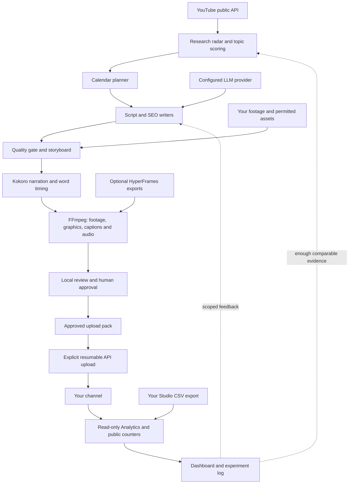
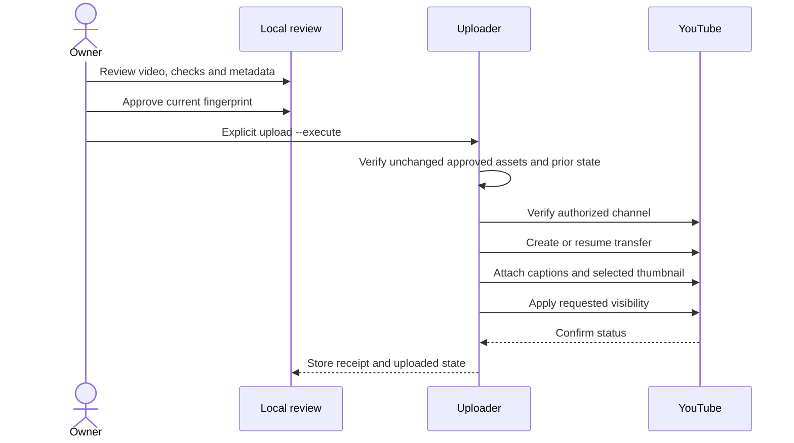
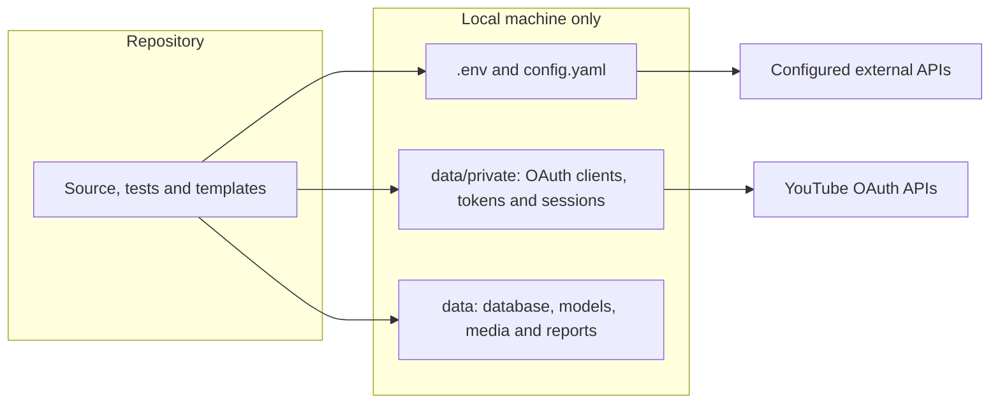

# YT Automation

A local video-production pipeline for researching ideas, writing scripts, assembling videos and Shorts, reviewing them, publishing approved uploads, and learning from audience results.

We built it to make production repeatable: keep scripts, footage, narration, captions, metadata and performance records connected, reduce repetitive editing/upload work, and measure what needs improving. A person still reviews the finished video and authorizes publication. The software does not predict viral videos or guarantee revenue.

This repository contains reusable code, templates and tests. Actual videos, reports, internal plans, historical channel data and account connections are excluded. The included research/writing defaults target AI tools and productivity; other subjects need their own research terms, prompts and editorial direction.

## Architecture



Python coordinates the workflow. SQLite holds research, scripts and analytics. FFmpeg assembles short intermediate shots to limit memory use, mixes narration/music, and burns captions. Optional HyperFrames exports supply editable motion scenes. Generated files live under ignored `data/`; they are not source files.

| Module | Responsibility |
|---|---|
| `core/` | Configuration, SQLite, logging, FFmpeg helpers and Gemini/Groq adapters |
| `research/` | YouTube API client, quota tracking, signals, filtering, scoring and calendar |
| `writing/` | Structured scripts, quality gate, revisions, title/description/tag drafts |
| `production/` | Storyboard, Kokoro voice, alignment, footage, graphics, thumbnails and Shorts |
| `publishing/` | Local review UI, approvals, upload packs and resumable API uploader |
| `analytics/` | Read-only reports, offline dashboard, experiments, feedback and income ledger |
| `income/` | Potential-client research, unsent drafts and permission-based campaign clips |
| `motion/package*.json` | Pinned optional HyperFrames dependencies |
| `examples/` | Empty/synthetic input templates |
| `tests/` | Synthetic and mocked verification |

## Step-by-step setup

Commands use **Windows PowerShell**, the primary development environment. On other platforms, replace virtual-environment paths, encoder choices and Windows scheduling commands.

### 1. Install prerequisites

Install Git, **Python 3.11**, and FFmpeg/FFprobe. Node.js **22+** is optional for HyperFrames.

```powershell
winget install --id Git.Git -e
winget install --id Python.Python.3.11 -e
winget install --id Gyan.FFmpeg -e
# Optional:
winget install --id OpenJS.NodeJS.LTS -e
```

Open a new terminal, then check `git --version`, `py -3.11 --version`, `ffmpeg -version` and `ffprobe -version`.

### 2. Clone and install dependencies

Copy the clone URL from this repository's **Code** button and replace `YOUR_REPOSITORY_URL`:

```powershell
git clone YOUR_REPOSITORY_URL yt-automation
cd yt-automation
py -3.11 -m venv .venv
.venv\Scripts\python.exe -m pip install --upgrade pip
.venv\Scripts\python.exe -m pip install -r requirements.txt
```

Calling the virtual environment's executable directly avoids PowerShell activation-policy issues. Speech/image dependencies can be sizable. Model weights are not bundled.

### 3. Create your local settings

```powershell
Copy-Item .env.example .env
Copy-Item config.example.yaml config.yaml
```

Both destination files are ignored by Git. Fill integration keys in `.env` locally:

| Variable | Purpose |
|---|---|
| `YOUTUBE_API_KEY` | Public topic research, counters and comment reads |
| `GEMINI_API_KEY` or `GROQ_API_KEY` | Writing, quality review and SEO |
| `PEXELS_API_KEY` / `PIXABAY_API_KEY` | Optional stock sources |
| `TELEGRAM_BOT_TOKEN`, `TELEGRAM_CHAT_ID` | Optional explicitly requested report delivery |

Set `llm.providers` in `config.yaml` to model IDs actually available to your provider account; the example uses explicit placeholders. Configure keywords, scoring, voice and editorial rules there. The shared example uses `libx264` for CPU rendering; select `h264_qsv` only if your machine and FFmpeg support Intel Quick Sync.

### 4. Configure public YouTube API access

In [Google Cloud Console](https://console.cloud.google.com/), create/select **your own project**, enable **YouTube Data API v3**, create an API key, and put it in `.env`. Restrict the key to the required API and appropriate application environment. Public research does not need a connected channel. Private Analytics and uploads use separate OAuth authorization below.

### 5. Download narration models

Download these upstream [Kokoro ONNX release assets](https://github.com/thewh1teagle/kokoro-onnx/releases/tag/model-files-v1.0) into the ignored model directory:

```powershell
New-Item -ItemType Directory -Force data\models | Out-Null
Invoke-WebRequest -Uri https://github.com/thewh1teagle/kokoro-onnx/releases/download/model-files-v1.0/kokoro-v1.0.int8.onnx -OutFile data\models\kokoro-v1.0.int8.onnx
Invoke-WebRequest -Uri https://github.com/thewh1teagle/kokoro-onnx/releases/download/model-files-v1.0/voices-v1.0.bin -OutFile data\models\voices-v1.0.bin
```

Choose an available Kokoro voice in `config.yaml`. Faster Whisper may download its caption-alignment model on first use. Review upstream licenses before redistributing weights or media.

### 6. Verify installation

```powershell
.venv\Scripts\python.exe -m pytest -q
.venv\Scripts\python.exe scripts\check_source_privacy.py --tracked
git config core.hooksPath .githooks
```

Tests use synthetic data and mocked services; they do not need personal credentials, publish videos or send messages. The pre-commit hook checks staged source files for prohibited paths and common private-data patterns.

### 7. Research, plan and write

```powershell
.venv\Scripts\python.exe main.py run
.venv\Scripts\python.exe main.py ideas --top 10
.venv\Scripts\python.exe main.py plan
.venv\Scripts\python.exe main.py write --limit 1
```

Review each video's script, SEO and storyboard under `data/outputs/videos/`. Topic scores are heuristics, not proven demand or predicted views. LLM/API usage follows your provider's quotas and pricing.

### 8. Supply media and render

Verify claims and visual cues first. A promised software demonstration needs an actual recording; the storyboard lists required filenames. Place recordings in the video's `screen/` folder. Source offsets and camera crops allow reuse of a recording across narrated steps.

Add music you are permitted to use under `assets/music/`; no music or recordings are shipped. Preserve permissions/attribution evidence locally. Add stock keys if needed. Relevance and permissions still require review.

```powershell
.venv\Scripts\python.exe main.py storyboard --limit 1
.venv\Scripts\python.exe main.py voice --limit 1
.venv\Scripts\python.exe main.py render --limit 1
.venv\Scripts\python.exe main.py shorts --limit 1
```

Inspect the actual final file for factual accuracy, captions, timing, audio and line-to-shot matching. Vertical dimensions alone do not establish YouTube Shorts classification; check the processed upload's actual Shorts tab/player.

### 9. Review and approve locally

```powershell
.venv\Scripts\python.exe main.py digest
```

Open **http://127.0.0.1:8765**. Inspect the video, checks and metadata, then approve/reject it. Approval binds current assets through a fingerprint; later edits invalidate it. The UI can change local approval state and serve working files. Keep it on loopback, avoid public tunnels, and stop it with **Ctrl+C**.

### 10. Connect your own channel for uploads

Configure the OAuth consent screen in your Cloud project, add your own test account when applicable, and create a **Desktop app OAuth client**. Save its downloaded JSON to ignored `data/private/client-secrets.json`. Set `publishing.expected_channel_id` to **your** channel ID in local `config.yaml`.

```powershell
.venv\Scripts\python.exe main.py youtube-auth --client-secrets data/private/client-secrets.json
```

Choose the intended channel in Google's window. Upload authorization uses `youtube.force-ssl`, a broad permission for videos/captions; read Google's consent screen. Tokens and resumable session URLs stay in ignored `data/private/youtube/`.

Set `api_upload_enabled: true` only when ready. The video's `pack.json` needs explicit privacy, audience and synthetic-media settings. Use the item ID shown by the digest:

```powershell
# Dry-run: shows the proposed upload and blockers.
.venv\Scripts\python.exe main.py upload ITEM_ID
# Remote write: only after approving this exact video and metadata.
.venv\Scripts\python.exe main.py upload ITEM_ID --execute
```



The uploader protects against wrong-channel writes, changed approvals and duplicates. An interrupted upload can have an uncertain outcome; inspect state/Studio before retrying. The regular daily production command does not publish.

### 11. Connect Analytics and inspect results

Enable **YouTube Analytics API** in your own project and authorize the separate read-only connection:

```powershell
.venv\Scripts\python.exe main.py analytics auth --client-secrets data/private/client-secrets.json
.venv\Scripts\python.exe main.py analytics sync --comments
.venv\Scripts\python.exe main.py analytics dashboard
```

Open **http://127.0.0.1:8767**, or `data/outputs/analytics/index.html` for the offline dashboard. Once connected, that generated file contains private metrics: keep it local. `analytics report` rebuilds from stored data without fetching.

Public counters are lifetime snapshots; private reports retain their own Pacific-time dates and reporting delay. Empty/suppressed metrics remain unknown. New videos need reporting time and more comparable observations. Record verified format and editorial choices:

```powershell
.venv\Scripts\python.exe main.py analytics annotate VIDEO_ID --format short --topic "Your topic" --hook-style "Your hook choice"
.venv\Scripts\python.exe main.py analytics import-studio PATH_TO_EXPORT.csv --start YYYY-MM-DD --end YYYY-MM-DD
```

CTR and stayed-to-watch require a per-video Studio CSV export with its actual selected date range. An empty normalized template is in `examples/studio_metrics.csv`. Feedback reaches scoring, script/SEO prompts and long-form thumbnail ordering only when niche, format and sample rules match. Comparisons use the first three complete Pacific days after the partial upload day. Associations suggest experiments; they do not prove a cause. Comment replies remain unsent drafts.

### 12. Optional motion, business tools and scheduling

No previous production compositions or assets are included. Install the pinned dependencies and scaffold **your own** motion project:

```powershell
npm.cmd ci --prefix motion
Push-Location motion
node node_modules/hyperframes/bin/hyperframes.mjs init studio --non-interactive --skip-skills
Pop-Location
.venv\Scripts\python.exe main.py motion
```

Author the scene/assets before rendering. The integrated motion exporter expects measurable audio. Checked MP4 inserts for ordinary videos use `motion-scenes.json`, mapping script-line indexes and canvas sizes to paths inside the video's folder.

Use `main.py clients --help`, `main.py campaign --help` and `main.py analytics income --help` for business tools. Client drafts are not sent; campaigns require permission declarations/evidence; received-payment records remain separate from estimates. Optional revenue Analytics needs `analytics auth --monetary` and appropriate channel eligibility.

Scheduling is opt-in, at **PC local time**:

```powershell
# Research and production; inspect quota/render limits first.
powershell -ExecutionPolicy Bypass -File scripts\schedule.ps1
# Read-only daily growth report at 19:00.
powershell -ExecutionPolicy Bypass -File scripts\schedule-analytics.ps1
```

Tasks require a configured machine and may need elevated permissions. Manage/remove them in Windows Task Scheduler. Cloning this repository installs no tasks. With bot/chat variables configured, `analytics notify` inspects the Telegram draft; `analytics notify --send` explicitly delivers it. Scheduled reports do not send Telegram messages by default.

## Privacy boundary



Research queries and configured LLM prompts go to their providers. Explicit uploads send selected media/metadata to YouTube; explicit Telegram delivery sends a report to the configured chat. Local storage does not make every integration offline.

Read [SECURITY.md](SECURITY.md). The shared tree has no connected Google account, actual channel IDs, existing video links, OAuth client JSON, tokens, private database, report, internal plan or previous working history. Every installation connects its own accounts. Check the actual staged tree before pushing: ignore rules alone cannot remove files already tracked in history.

## Limits and troubleshooting

Prompts remain domain-specific, media needs editorial review, permission claims are not automatically proven, and growth decisions need enough real data. Views, search rank, income and Shorts distribution are not guaranteed. Before/after packaging changes alone do not establish causation.

Missing configuration: complete Step 3. Missing narration weights: Step 5. Missing SCREEN recordings: follow the storyboard. Encoder failure: start with `libx264`. OAuth/API errors: check project selection, enablement, requested scopes and channel selection. Never paste credentials into issues or attach generated reports to them.
